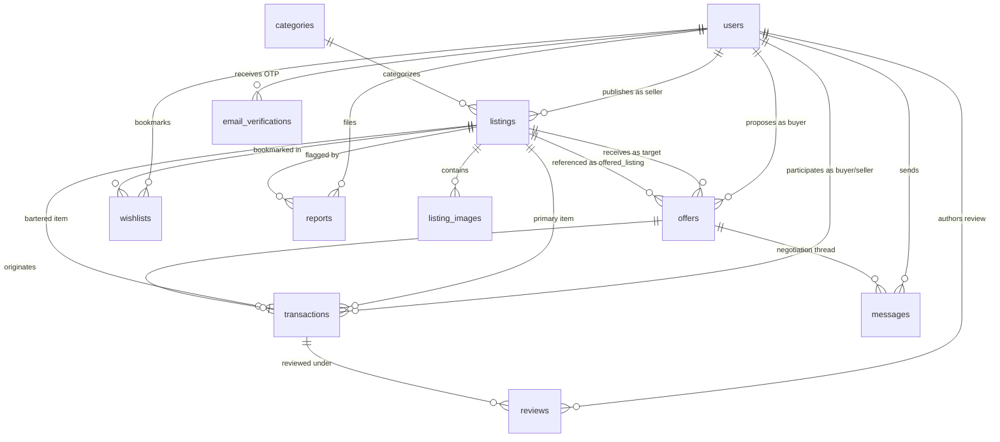

# CampusSwap — Relational Database Schema Specification

**Target DBMS:** MySQL 8.0+  
**Storage Engine:** InnoDB  
**Character Set & Collation:** `utf8mb4` / `utf8mb4_unicode_ci`  
**Document Purpose:** Relational Schema Architecture & DDL Reference for `docs/PROJECT_SPEC.md`  

---

## 1. Schema Overview & Design Philosophy

The **CampusSwap** database architecture models a secure, college-restricted marketplace supporting **Direct Sales**, **Item Barter**, and **Free Giveaways**.

### Key Architectural Tenets:
1. **Third Normal Form (3NF) Compliance:** Eliminates partial key dependencies and transitive dependencies. Aggregated attributes (such as user average rating and review counts) are computed dynamically using relational queries and indexed views rather than stored as denormalized redundant columns.
2. **ACID Transactions & Strict State Machines:** State transitions (`ACTIVE` $\rightarrow$ `RESERVED` $\rightarrow$ `COMPLETED`) are controlled through enumeration constraints, composite checks, and atomic transaction locks (`SELECT ... FOR UPDATE`), preventing race conditions such as duplicate claims or simultaneous multi-buyer commitments.
3. **Multi-Modal Offer Structure:** The `offers` entity flexibly accommodates monetary bids (`SELL`), item-for-item proposals referencing an active offered listing with an optional cash difference (`BARTER`), and zero-cost giveaway reservations (`FREE`).
4. **Referential & Domain Integrity:** Foreign key referential actions are strictly designated (`ON DELETE RESTRICT` for financial and auditing trails, `ON DELETE CASCADE` for tightly bound dependent child attributes such as listing images). Explicit `CHECK` constraints enforce business boundaries at the storage layer.

---

## 2. Standardized Enumerations & Domain Values

To align the database schema with the backend API contract and UI state machines, all enum values are standardized in uppercase:

### 2.1 User Roles & Account Statuses
- **`user_role`**: `'STUDENT'`, `'ADMIN'`
- **`user_status`**: `'PENDING_VERIFICATION'`, `'ACTIVE'`, `'SUSPENDED'`

### 2.2 Listing Modes, Conditions & Statuses
- **`listing_mode`**: 
  - `'SELL'`: Monetary transaction with an asking price; open to cash offers and counteroffers.
  - `'BARTER'`: Exchange for another physical item; optionally accompanied by cash difference.
  - `'FREE'`: Zero-price giveaway; claimed on a first-come, first-served basis.
- **`item_condition`**: `'NEW'`, `'LIKE_NEW'`, `'GOOD'`, `'FAIR'`
- **`listing_status`**: 
  - `'ACTIVE'`: Visible in public search; open to offers and claims.
  - `'RESERVED'`: Bound to an accepted offer or claim; pending physical handover.
  - `'COMPLETED'`: Transaction successfully fulfilled; archived as permanent history.
  - `'CANCELLED'`: Delisted or aborted by the listing owner.
  - `'DELETED_BY_ADMIN'`: Hidden by campus moderators due to policy violations.

### 2.3 Offer Types & Statuses
- **`offer_type`**: `'PURCHASE'`, `'BARTER'`, `'CLAIM'`
- **`offer_status`**: 
  - `'PENDING'`: Awaiting seller review.
  - `'COUNTERED'`: Seller responded with a counter cash amount; awaiting buyer decision.
  - `'ACCEPTED'`: Agreed upon; immediately moves target listing(s) to `RESERVED`.
  - `'REJECTED'`: Explicitly declined by the seller or buyer.
  - `'WITHDRAWN'`: Cancelled by the proposer prior to acceptance.
  - `'CANCELLED_BY_SYSTEM'`: Automatically voided when another competing offer is accepted.

### 2.4 Transaction Modalities & Statuses
- **`transaction_type`**: `'SALE'`, `'BARTER'`, `'FREE_GIVEAWAY'`
- **`transaction_status`**: 
  - `'PENDING_MEETUP'`: Offer accepted; parties are coordinating on-campus handover.
  - `'COMPLETED'`: Handover confirmed; items transferred; reviews unlocked.
  - `'CANCELLED'`: Handover failed or aborted; listings revert to `ACTIVE` or `CANCELLED`.

### 2.5 Report Reasons & Statuses
- **`report_reason`**: `'PROHIBITED_ITEM'`, `'INAPPROPRIATE_CONTENT'`, `'SUSPECTED_SCAM'`, `'HARASSMENT'`, `'DUPLICATE_SPAM'`
- **`report_status`**: `'PENDING'`, `'UNDER_REVIEW'`, `'RESOLVED'`, `'DISMISSED'`

---

## 3. Entity-Relationship (ER) Architecture

### 3.1 Entity Cardinalities & Structural Relationships
- **`users` to `listings`** ($1 : N$): A student can publish multiple listings; each listing has exactly one seller.
- **`categories` to `listings`** ($1 : N$): A category organizes multiple listings; each listing belongs to one category.
- **`listings` to `listing_images`** ($1 : N$): A listing can feature up to 5 image URLs; each image belongs to one listing.
- **`listings` to `offers`** ($1 : N$): A target listing can receive multiple competing offers from different prospective buyers.
- **`listings` (as offered item) to `offers`** ($0..1 : N$): A student's active listing can be referenced as barter collateral in an offer.
- **`offers` to `transactions`** ($1 : 1$): An accepted offer generates exactly one official transaction record.
- **`transactions` to `reviews`** ($1 : 0..2$): A completed transaction allows at most two reviews (one from the buyer and one from the seller).
- **`users` to `wishlists`** ($1 : N$) and **`listings` to `wishlists`** ($1 : N$): Resolves the $M : N$ relationship between students and bookmarked listings.
- **`listings` / `offers` to `messages`** ($1 : N$): Messages are scoped to an offer negotiation thread regarding a specific listing.
- **`users` / `listings` to `reports`** ($1 : N$): Students submit moderation flags on suspect listings or abusive counterparties.

### 3.2 Mermaid ER Diagram



---

## 4. Detailed Data Dictionary

### 4.1 `users`
Stores student and administrator account credentials, verification standing, and profile attributes.

| Column Name | Data Type | Nullable | Default | Constraints / Descriptions |
| :--- | :--- | :---: | :---: | :--- |
| `id` | `BIGINT UNSIGNED` | No | Auto Inc | Primary Key |
| `email` | `VARCHAR(255)` | No | None | Unique. Institutional email domain (e.g., `@college.edu`) |
| `password_hash` | `VARCHAR(255)` | No | None | Bcrypt salted hash string |
| `full_name` | `VARCHAR(100)` | No | None | Student legal or display name |
| `phone_number` | `VARCHAR(20)` | Yes | `NULL` | Optional contact number for on-campus handover |
| `department` | `VARCHAR(100)` | Yes | `NULL` | Academic department (e.g., Computer Science, Mechanical) |
| `role` | `ENUM('STUDENT','ADMIN')` | No | `'STUDENT'` | User access control role |
| `status` | `ENUM(...)` | No | `'PENDING_VERIFICATION'` | `'PENDING_VERIFICATION'`, `'ACTIVE'`, `'SUSPENDED'` |
| `created_at` | `TIMESTAMP` | No | `CURRENT_TIMESTAMP` | Row creation timestamp |
| `updated_at` | `TIMESTAMP` | No | `CURRENT_TIMESTAMP ON UPDATE` | Row update timestamp |

---

### 4.2 `email_verifications`
Tracks 6-digit one-time password (OTP) verification tokens with a strict expiration window.

| Column Name | Data Type | Nullable | Default | Constraints / Descriptions |
| :--- | :--- | :---: | :---: | :--- |
| `id` | `BIGINT UNSIGNED` | No | Auto Inc | Primary Key |
| `user_id` | `BIGINT UNSIGNED` | No | None | Foreign Key $\rightarrow$ `users(id)` ON DELETE CASCADE |
| `otp_code` | `VARCHAR(6)` | No | None | 6-digit verification code |
| `expires_at` | `DATETIME` | No | None | Token validity limit (typically 15 minutes) |
| `is_used` | `BOOLEAN` | No | `FALSE` | Set to `TRUE` upon successful validation |
| `created_at` | `TIMESTAMP` | No | `CURRENT_TIMESTAMP` | Row creation timestamp |

---

### 4.3 `categories`
Defines item categories for faceted search and marketplace organization.

| Column Name | Data Type | Nullable | Default | Constraints / Descriptions |
| :--- | :--- | :---: | :---: | :--- |
| `id` | `INT UNSIGNED` | No | Auto Inc | Primary Key |
| `name` | `VARCHAR(50)` | No | None | Unique category name (e.g., 'Textbooks', 'Electronics') |
| `description` | `VARCHAR(255)` | Yes | `NULL` | Scope of items accepted in this category |
| `is_active` | `BOOLEAN` | No | `TRUE` | Soft-disable obsolete categories |
| `created_at` | `TIMESTAMP` | No | `CURRENT_TIMESTAMP` | Row creation timestamp |

---

### 4.4 `listings`
Core inventory table storing goods offered for direct sale, barter, or giveaway.

| Column Name | Data Type | Nullable | Default | Constraints / Descriptions |
| :--- | :--- | :---: | :---: | :--- |
| `id` | `BIGINT UNSIGNED` | No | Auto Inc | Primary Key |
| `seller_id` | `BIGINT UNSIGNED` | No | None | Foreign Key $\rightarrow$ `users(id)` ON DELETE RESTRICT |
| `category_id` | `INT UNSIGNED` | No | None | Foreign Key $\rightarrow$ `categories(id)` ON DELETE RESTRICT |
| `title` | `VARCHAR(100)` | No | None | Searchable title |
| `description` | `TEXT` | No | None | Item specifications, syllabus edition, etc. |
| `mode` | `ENUM('SELL','BARTER','FREE')` | No | None | Exchange mode |
| `price` | `DECIMAL(10,2)` | Yes | `NULL` | Required if `mode = 'SELL'`; forced to `0.00` if `mode = 'FREE'` |
| `is_negotiable` | `BOOLEAN` | No | `FALSE` | Indicates whether seller entertains lower offers |
| `barter_preferences`| `VARCHAR(255)` | Yes | `NULL` | Description of sought trade goods (if `mode = 'BARTER'`) |
| `item_condition` | `ENUM(...)` | No | `'GOOD'` | `'NEW'`, `'LIKE_NEW'`, `'GOOD'`, `'FAIR'` |
| `pickup_location` | `VARCHAR(150)` | No | None | Pre-designated campus spot (e.g., 'Student Center Desk') |
| `status` | `ENUM(...)` | No | `'ACTIVE'` | `'ACTIVE'`, `'RESERVED'`, `'COMPLETED'`, `'CANCELLED'`, `'DELETED_BY_ADMIN'` |
| `created_at` | `TIMESTAMP` | No | `CURRENT_TIMESTAMP` | Listing publication timestamp |
| `updated_at` | `TIMESTAMP` | No | `CURRENT_TIMESTAMP ON UPDATE` | Last status or detail modification |

**Table Check Constraints:**
chk_listing_price:
CHECK (
    (mode = 'SELL' AND price IS NOT NULL AND price > 0.00)
    OR
    (mode = 'FREE' AND price = 0.00)
    OR
    (mode = 'BARTER' AND (price IS NULL OR price >= 0.00))
),

chk_barter_desc:
CHECK (
    mode != 'BARTER' OR barter_preferences IS NOT NULL
)

---

### 4.5 `listing_images`
Maintains up to 5 uploaded image references per listing.

| Column Name | Data Type | Nullable | Default | Constraints / Descriptions |
| :--- | :--- | :---: | :---: | :--- |
| `id` | `BIGINT UNSIGNED` | No | Auto Inc | Primary Key |
| `listing_id` | `BIGINT UNSIGNED` | No | None | Foreign Key $\rightarrow$ `listings(id)` ON DELETE CASCADE |
| `image_url` | `VARCHAR(500)` | No | None | URL / local path to the stored image file |
| `display_order` | `TINYINT UNSIGNED` | No | `1` | Ordering index (1 = Primary cover image) |
| `created_at` | `TIMESTAMP` | No | `CURRENT_TIMESTAMP` | Row creation timestamp |

---

### 4.6 `offers`
Captures purchase bids, barter exchanges, and giveaway claims.

| Column Name | Data Type | Nullable | Default | Constraints / Descriptions |
| :--- | :--- | :---: | :---: | :--- |
| `id` | `BIGINT UNSIGNED` | No | Auto Inc | Primary Key |
| `listing_id` | `BIGINT UNSIGNED` | No | None | Foreign Key $\rightarrow$ `listings(id)` ON DELETE RESTRICT (Target Item) |
| `buyer_id` | `BIGINT UNSIGNED` | No | None | Foreign Key $\rightarrow$ `users(id)` ON DELETE RESTRICT (Offer Proposer) |
| `offer_type` | `ENUM('PURCHASE','BARTER','CLAIM')` | No | None | Offer modality matching or adapting the listing mode |
| `offered_price` | `DECIMAL(10,2)` | Yes | `NULL` | Buyer proposed cash amount (for `PURCHASE`) |
| `offered_listing_id`| `BIGINT UNSIGNED` | Yes | `NULL` | Foreign Key $\rightarrow$ `listings(id)` ON DELETE RESTRICT (Trade item) |
| `cash_difference` | `DECIMAL(10,2)` | No | `0.00` | Additional cash offered in a barter deal |
| `counter_price` | `DECIMAL(10,2)` | Yes | `NULL` | Seller counteroffer price during negotiations |
| `message` | `VARCHAR(500)` | Yes | `NULL` | Initial introductory proposal note |
| `status` | `ENUM(...)` | No | `'PENDING'` | `'PENDING'`, `'COUNTERED'`, `'ACCEPTED'`, `'REJECTED'`, `'WITHDRAWN'`, `'CANCELLED_BY_SYSTEM'` |
| `created_at` | `TIMESTAMP` | No | `CURRENT_TIMESTAMP` | Proposal submission timestamp |
| `updated_at` | `TIMESTAMP` | No | `CURRENT_TIMESTAMP ON UPDATE` | Last status/counter update |

**Table Check Constraints:**
- `chk_offer_self`: `CHECK (offered_listing_id IS NULL OR offered_listing_id != listing_id)`
- `chk_offer_cash_diff`: `CHECK (cash_difference >= 0.00)`
- `chk_offer_purchase_price`: `CHECK (offer_type != 'PURCHASE' OR offered_price > 0.00)`

---

### 4.7 `transactions`
Immutable ledger recording finalized agreements, physical handovers, and settlement details.

| Column Name | Data Type | Nullable | Default | Constraints / Descriptions |
| :--- | :--- | :---: | :---: | :--- |
| `id` | `BIGINT UNSIGNED` | No | Auto Inc | Primary Key |
| `offer_id` | `BIGINT UNSIGNED` | No | None | Unique. Foreign Key $\rightarrow$ `offers(id)` ON DELETE RESTRICT |
| `listing_id` | `BIGINT UNSIGNED` | No | None | Foreign Key $\rightarrow$ `listings(id)` ON DELETE RESTRICT |
| `seller_id` | `BIGINT UNSIGNED` | No | None | Foreign Key $\rightarrow$ `users(id)` ON DELETE RESTRICT |
| `buyer_id` | `BIGINT UNSIGNED` | No | None | Foreign Key $\rightarrow$ `users(id)` ON DELETE RESTRICT |
| `transaction_type` | `ENUM('SALE','BARTER','FREE_GIVEAWAY')` | No | None | Agreement modality |
| `final_price` | `DECIMAL(10,2)` | No | `0.00` | Agreed monetary settlement: sale price (for `SALE`), or agreed cash difference (for `BARTER`), or `0.00` (for `FREE_GIVEAWAY` or even barter) |
| `barter_listing_id`| `BIGINT UNSIGNED` | Yes | `NULL` | Foreign Key $\rightarrow$ `listings(id)` ON DELETE RESTRICT (Trade item if `transaction_type = 'BARTER'`) |
| `status` | `ENUM(...)` | No | `'PENDING_MEETUP'` | `'PENDING_MEETUP'`, `'COMPLETED'`, `'CANCELLED'` |
| `completed_at` | `DATETIME` | Yes | `NULL` | Timestamp when physical handover was confirmed |
| `created_at` | `TIMESTAMP` | No | `CURRENT_TIMESTAMP` | Record creation timestamp |

**Table Check Constraints:**
- `chk_tx_parties`: `CHECK (seller_id != buyer_id)`
- `chk_tx_final_price`: `CHECK (final_price >= 0.00)`
- `chk_tx_barter_item`: `CHECK (transaction_type != 'BARTER' OR barter_listing_id IS NOT NULL)`

---

### 4.8 `reviews`
Stores bilateral feedback ratings (1–5 stars) between transaction counterparties.

| Column Name | Data Type | Nullable | Default | Constraints / Descriptions |
| :--- | :--- | :---: | :---: | :--- |
| `id` | `BIGINT UNSIGNED` | No | Auto Inc | Primary Key |
| `transaction_id` | `BIGINT UNSIGNED` | No | None | Foreign Key $\rightarrow$ `transactions(id)` ON DELETE RESTRICT |
| `reviewer_id` | `BIGINT UNSIGNED` | No | None | Foreign Key $\rightarrow$ `users(id)` ON DELETE RESTRICT (Author) |
| `reviewee_id` | `BIGINT UNSIGNED` | No | None | Foreign Key $\rightarrow$ `users(id)` ON DELETE RESTRICT (Target) |
| `rating` | `TINYINT UNSIGNED` | No | None | Rating score from 1 to 5 |
| `comment` | `TEXT` | Yes | `NULL` | Written review feedback |
| `created_at` | `TIMESTAMP` | No | `CURRENT_TIMESTAMP` | Review submission timestamp |

**Unique Constraints & Checks:**
- `UNIQUE KEY uq_transaction_reviewer (transaction_id, reviewer_id)`: Prevents multiple reviews by the same user on one transaction.
- `chk_rating_range`: `CHECK (rating BETWEEN 1 AND 5)`
- `chk_review_self`: `CHECK (reviewer_id != reviewee_id)`

---

### 4.9 `messages`
Negotiation messaging scoped directly to a specific listing and offer thread.

| Column Name | Data Type | Nullable | Default | Constraints / Descriptions |
| :--- | :--- | :---: | :---: | :--- |
| `id` | `BIGINT UNSIGNED` | No | Auto Inc | Primary Key |
| `offer_id` | `BIGINT UNSIGNED` | No | None | Foreign Key $\rightarrow$ `offers(id)` ON DELETE CASCADE |
| `sender_id` | `BIGINT UNSIGNED` | No | None | Foreign Key $\rightarrow$ `users(id)` ON DELETE RESTRICT |
| `message_text` | `TEXT` | No | None | Message content |
| `is_read` | `BOOLEAN` | No | `FALSE` | Read receipt flag |
| `sent_at` | `TIMESTAMP` | No | `CURRENT_TIMESTAMP` | Transmission timestamp |

---

### 4.10 `wishlists`
Junction table tracking items saved/bookmarked by students.

| Column Name | Data Type | Nullable | Default | Constraints / Descriptions |
| :--- | :--- | :---: | :---: | :--- |
| `id` | `BIGINT UNSIGNED` | No | Auto Inc | Primary Key |
| `user_id` | `BIGINT UNSIGNED` | No | None | Foreign Key $\rightarrow$ `users(id)` ON DELETE CASCADE |
| `listing_id` | `BIGINT UNSIGNED` | No | None | Foreign Key $\rightarrow$ `listings(id)` ON DELETE CASCADE |
| `created_at` | `TIMESTAMP` | No | `CURRENT_TIMESTAMP` | Save timestamp |

**Unique Constraint:**
- `UNIQUE KEY uq_user_wishlist_listing (user_id, listing_id)`: Prevents duplicate bookmarks.

---

### 4.11 `reports`
Auditing and abuse reporting tickets filed by students for administrative resolution.

| Column Name | Data Type | Nullable | Default | Constraints / Descriptions |
| :--- | :--- | :---: | :---: | :--- |
| `id` | `BIGINT UNSIGNED` | No | Auto Inc | Primary Key |
| `reporter_id` | `BIGINT UNSIGNED` | No | None | Foreign Key $\rightarrow$ `users(id)` ON DELETE RESTRICT |
| `reported_user_id`| `BIGINT UNSIGNED` | Yes | `NULL` | Foreign Key $\rightarrow$ `users(id)` ON DELETE SET NULL |
| `listing_id` | `BIGINT UNSIGNED` | Yes | `NULL` | Foreign Key $\rightarrow$ `listings(id)` ON DELETE SET NULL |
| `reason` | `ENUM(...)` | No | None | Reason code matching Section 2.5 |
| `details` | `TEXT` | No | None | Context and evidence provided by reporter |
| `status` | `ENUM(...)` | No | `'PENDING'` | `'PENDING'`, `'UNDER_REVIEW'`, `'RESOLVED'`, `'DISMISSED'` |
| `admin_notes` | `TEXT` | Yes | `NULL` | Resolution notes entered by campus admin |
| `resolved_by` | `BIGINT UNSIGNED` | Yes | `NULL` | Foreign Key $\rightarrow$ `users(id)` ON DELETE SET NULL |
| `resolved_at` | `DATETIME` | Yes | `NULL` | Resolution timestamp |
| `created_at` | `TIMESTAMP` | No | `CURRENT_TIMESTAMP` | Submission timestamp |

**Table Check Constraint:**
- `chk_report_target`: `CHECK (reported_user_id IS NOT NULL OR listing_id IS NOT NULL)`

---

## 5. Concurrency Control & Row-Locking Strategy

### 5.1 The Double-Commit Problem in Campus Marketplaces
In a student marketplace, concurrency vulnerabilities arise when:
1. Two students simultaneously attempt to claim the same free item (`FREE`).
2. A seller receives multiple high offers on a textbook and attempts to accept one while another buyer attempts to claim it.
3. In a barter exchange, two different sellers simultaneously attempt to accept barter offers referencing the *same* offered listing from a third student.

### 5.2 Transaction Reservation Algorithm

To prevent double-selling and race conditions, state transitions execute inside an isolated transaction using pessimistic row locking (`SELECT ... FOR UPDATE`):

```sql
-- STEP 1: Begin transaction
START TRANSACTION;

-- STEP 2: Acquire pessimistic row-level locks on the involved listing(s) in deterministic order
-- In single-item transactions (SELL or FREE): lock target_listing_id
-- In dual-item transactions (BARTER): to prevent deadlocks, sort IDs and lock LEAST(target_listing_id, offered_listing_id) first, then GREATEST(target_listing_id, offered_listing_id)
SELECT id, seller_id, mode, status 
FROM listings 
WHERE id = LEAST(:target_listing_id, COALESCE(:offered_listing_id, :target_listing_id))
FOR UPDATE;

-- If barter transaction, lock the second listing:
SELECT id, seller_id, mode, status 
FROM listings 
WHERE id = GREATEST(:target_listing_id, :offered_listing_id)
FOR UPDATE;

-- Application Verification:
-- Ensure target listing status == 'ACTIVE'. If not active, emit ROLLBACK and return 409 Conflict.
-- If barter: ensure offered listing status == 'ACTIVE' and seller_id == proposer_id. If not, ROLLBACK and return 400/409.

-- STEP 3: Lock and verify the offer record
SELECT id, status, offered_price, cash_difference 
FROM offers 
WHERE id = :offer_id AND listing_id = :target_listing_id 
FOR UPDATE;

-- STEP 5: Mutate listings state to 'RESERVED'
UPDATE listings 
SET status = 'RESERVED' 
WHERE id IN (:target_listing_id, :offered_listing_id);

-- STEP 6: Mark this offer as 'ACCEPTED'
UPDATE offers 
SET status = 'ACCEPTED' 
WHERE id = :offer_id;

-- STEP 7: Invalidate all competing pending offers for the target listing
UPDATE offers 
SET status = 'CANCELLED_BY_SYSTEM' 
WHERE listing_id = :target_listing_id 
  AND id != :offer_id 
  AND status IN ('PENDING', 'COUNTERED');

-- STEP 8 (If Barter): Also invalidate competing offers on the offered barter listing
UPDATE offers 
SET status = 'CANCELLED_BY_SYSTEM' 
WHERE listing_id = :offered_listing_id 
  AND id != :offer_id 
  AND status IN ('PENDING', 'COUNTERED');

-- STEP 9: Create the pending transaction record
INSERT INTO transactions (
    offer_id, listing_id, seller_id, buyer_id, 
    transaction_type, final_price, barter_listing_id, status
) VALUES (
    :offer_id, :target_listing_id, :seller_id, :buyer_id,
    :transaction_type, :agreed_final_price, :offered_listing_id, 'PENDING_MEETUP'
);

-- STEP 10: Commit atomic changes
COMMIT;
```

---

## 6. Comprehensive Indexing Strategy

Indexes are tailored to support query predicates without introducing excessive write overhead.

| Table | Index Name | Type | Indexed Columns | Justification / Query Target |
| :--- | :--- | :---: | :--- | :--- |
| `users` | `uq_users_email` | Unique | `(email)` | Instant login lookup; enforces unique institutional email |
| `categories` | `uq_categories_name` | Unique | `(name)` | Prevents duplicate category definitions |
| `listings` | `idx_listings_catalog` | B-Tree | `(status, category_id, created_at DESC)` | Primary faceted browsing and pagination query |
| `listings` | `idx_listings_mode_price`| B-Tree | `(status, mode, price)` | Price interval queries and mode filtering (`FREE`, `SELL`) |
| `listings` | `idx_listings_seller` | B-Tree | `(seller_id, status)` | Seller dashboard retrieval of active/reserved listings |
| `listings` | `ft_listings_search` | Full-Text | `(title, description)` | Keyword searching across product titles and descriptions |
| `listing_images`| `idx_images_listing` | B-Tree | `(listing_id, display_order)` | Fetching gallery images in display sequence |
| `offers` | `idx_offers_listing_status`| B-Tree | `(listing_id, status)` | Looking up pending offers on an item |
| `offers` | `idx_offers_buyer_status` | B-Tree | `(buyer_id, status)` | Student personal offer tracking dashboard |
| `offers` | `idx_offers_barter_item` | B-Tree | `(offered_listing_id)` | Checking if a listing is currently tied up in barter offers |
| `transactions`| `uq_transactions_offer` | Unique | `(offer_id)` | Guarantees an offer spawns at most one transaction |
| `transactions`| `idx_transactions_user` | B-Tree | `(seller_id, buyer_id, status)`| Transaction history lookups for both parties |
| `reviews` | `uq_reviews_tx_user` | Unique | `(transaction_id, reviewer_id)`| Enforces one review per participant per exchange |
| `reviews` | `idx_reviews_reviewee` | B-Tree | `(reviewee_id, rating)` | Computing average student reputation scores |
| `messages` | `idx_messages_thread` | B-Tree | `(offer_id, sent_at ASC)` | Sequential chat thread rendering |
| `wishlists` | `uq_wishlists_user_item` | Unique | `(user_id, listing_id)` | Prevents duplicate bookmarks |
| `reports` | `idx_reports_status` | B-Tree | `(status, created_at ASC)` | Admin moderation queue prioritization |

---

## 7. Complete DDL Script (Executable Order)

```sql
-- =============================================================================
-- CampusSwap Database Schema Definition (MySQL 8.0+ / InnoDB)
-- =============================================================================

SET FOREIGN_KEY_CHECKS = 0;
DROP TABLE IF EXISTS reports;
DROP TABLE IF EXISTS wishlists;
DROP TABLE IF EXISTS messages;
DROP TABLE IF EXISTS reviews;
DROP TABLE IF EXISTS transactions;
DROP TABLE IF EXISTS offers;
DROP TABLE IF EXISTS listing_images;
DROP TABLE IF EXISTS listings;
DROP TABLE IF EXISTS categories;
DROP TABLE IF EXISTS email_verifications;
DROP TABLE IF EXISTS users;
SET FOREIGN_KEY_CHECKS = 1;

-- -----------------------------------------------------------------------------
-- 1. USERS TABLE
-- -----------------------------------------------------------------------------
CREATE TABLE users (
    id BIGINT UNSIGNED AUTO_INCREMENT PRIMARY KEY,
    email VARCHAR(255) NOT NULL,
    password_hash VARCHAR(255) NOT NULL,
    full_name VARCHAR(100) NOT NULL,
    phone_number VARCHAR(20) DEFAULT NULL,
    department VARCHAR(100) DEFAULT NULL,
    role ENUM('STUDENT', 'ADMIN') NOT NULL DEFAULT 'STUDENT',
    status ENUM('PENDING_VERIFICATION', 'ACTIVE', 'SUSPENDED') NOT NULL DEFAULT 'PENDING_VERIFICATION',
    created_at TIMESTAMP NOT NULL DEFAULT CURRENT_TIMESTAMP,
    updated_at TIMESTAMP NOT NULL DEFAULT CURRENT_TIMESTAMP ON UPDATE CURRENT_TIMESTAMP,
    CONSTRAINT uq_users_email UNIQUE (email)
) ENGINE=InnoDB DEFAULT CHARSET=utf8mb4 COLLATE=utf8mb4_unicode_ci;

-- -----------------------------------------------------------------------------
-- 2. EMAIL_VERIFICATIONS TABLE
-- -----------------------------------------------------------------------------
CREATE TABLE email_verifications (
    id BIGINT UNSIGNED AUTO_INCREMENT PRIMARY KEY,
    user_id BIGINT UNSIGNED NOT NULL,
    otp_code VARCHAR(6) NOT NULL,
    expires_at DATETIME NOT NULL,
    is_used BOOLEAN NOT NULL DEFAULT FALSE,
    created_at TIMESTAMP NOT NULL DEFAULT CURRENT_TIMESTAMP,
    CONSTRAINT fk_verifications_user 
        FOREIGN KEY (user_id) REFERENCES users(id) 
        ON DELETE CASCADE ON UPDATE CASCADE,
    INDEX idx_verifications_user_lookup (user_id, otp_code, is_used)
) ENGINE=InnoDB DEFAULT CHARSET=utf8mb4 COLLATE=utf8mb4_unicode_ci;

-- -----------------------------------------------------------------------------
-- 3. CATEGORIES TABLE
-- -----------------------------------------------------------------------------
CREATE TABLE categories (
    id INT UNSIGNED AUTO_INCREMENT PRIMARY KEY,
    name VARCHAR(50) NOT NULL,
    description VARCHAR(255) DEFAULT NULL,
    is_active BOOLEAN NOT NULL DEFAULT TRUE,
    created_at TIMESTAMP NOT NULL DEFAULT CURRENT_TIMESTAMP,
    CONSTRAINT uq_categories_name UNIQUE (name)
) ENGINE=InnoDB DEFAULT CHARSET=utf8mb4 COLLATE=utf8mb4_unicode_ci;

-- -----------------------------------------------------------------------------
-- 4. LISTINGS TABLE
-- -----------------------------------------------------------------------------
CREATE TABLE listings (
    id BIGINT UNSIGNED AUTO_INCREMENT PRIMARY KEY,
    seller_id BIGINT UNSIGNED NOT NULL,
    category_id INT UNSIGNED NOT NULL,
    title VARCHAR(100) NOT NULL,
    description TEXT NOT NULL,
    mode ENUM('SELL', 'BARTER', 'FREE') NOT NULL,
    price DECIMAL(10,2) DEFAULT NULL,
    is_negotiable BOOLEAN NOT NULL DEFAULT FALSE,
    barter_preferences VARCHAR(255) DEFAULT NULL,
    item_condition ENUM('NEW', 'LIKE_NEW', 'GOOD', 'FAIR') NOT NULL DEFAULT 'GOOD',
    pickup_location VARCHAR(150) NOT NULL,
    status ENUM('ACTIVE', 'RESERVED', 'COMPLETED', 'CANCELLED', 'DELETED_BY_ADMIN') NOT NULL DEFAULT 'ACTIVE',
    created_at TIMESTAMP NOT NULL DEFAULT CURRENT_TIMESTAMP,
    updated_at TIMESTAMP NOT NULL DEFAULT CURRENT_TIMESTAMP ON UPDATE CURRENT_TIMESTAMP,
    CONSTRAINT fk_listings_seller 
        FOREIGN KEY (seller_id) REFERENCES users(id) 
        ON DELETE RESTRICT ON UPDATE CASCADE,
    CONSTRAINT fk_listings_category 
        FOREIGN KEY (category_id) REFERENCES categories(id) 
        ON DELETE RESTRICT ON UPDATE CASCADE,
    CONSTRAINT chk_listing_price 
        CHECK (
            (mode = 'SELL' AND price IS NOT NULL AND price > 0.00) OR 
            (mode = 'FREE' AND (price IS NULL OR price = 0.00)) OR 
            (mode = 'BARTER' AND (price IS NULL OR price >= 0.00))
        ),
    CONSTRAINT chk_barter_desc 
        CHECK (mode != 'BARTER' OR barter_preferences IS NOT NULL),
    INDEX idx_listings_catalog (status, category_id, created_at DESC),
    INDEX idx_listings_mode_price (status, mode, price),
    INDEX idx_listings_seller (seller_id, status),
    FULLTEXT INDEX ft_listings_search (title, description)
) ENGINE=InnoDB DEFAULT CHARSET=utf8mb4 COLLATE=utf8mb4_unicode_ci;

-- -----------------------------------------------------------------------------
-- 5. LISTING_IMAGES TABLE
-- -----------------------------------------------------------------------------
CREATE TABLE listing_images (
    id BIGINT UNSIGNED AUTO_INCREMENT PRIMARY KEY,
    listing_id BIGINT UNSIGNED NOT NULL,
    image_url VARCHAR(500) NOT NULL,
    display_order TINYINT UNSIGNED NOT NULL DEFAULT 1,
    created_at TIMESTAMP NOT NULL DEFAULT CURRENT_TIMESTAMP,
    CONSTRAINT fk_images_listing 
        FOREIGN KEY (listing_id) REFERENCES listings(id) 
        ON DELETE CASCADE ON UPDATE CASCADE,
    INDEX idx_images_listing (listing_id, display_order)
) ENGINE=InnoDB DEFAULT CHARSET=utf8mb4 COLLATE=utf8mb4_unicode_ci;

-- -----------------------------------------------------------------------------
-- 6. OFFERS TABLE
-- -----------------------------------------------------------------------------
CREATE TABLE offers (
    id BIGINT UNSIGNED AUTO_INCREMENT PRIMARY KEY,
    listing_id BIGINT UNSIGNED NOT NULL,
    buyer_id BIGINT UNSIGNED NOT NULL,
    offer_type ENUM('PURCHASE', 'BARTER', 'CLAIM') NOT NULL,
    offered_price DECIMAL(10,2) DEFAULT NULL,
    offered_listing_id BIGINT UNSIGNED DEFAULT NULL,
    cash_difference DECIMAL(10,2) NOT NULL DEFAULT 0.00,
    counter_price DECIMAL(10,2) DEFAULT NULL,
    message VARCHAR(500) DEFAULT NULL,
    status ENUM('PENDING', 'COUNTERED', 'ACCEPTED', 'REJECTED', 'WITHDRAWN', 'CANCELLED_BY_SYSTEM') NOT NULL DEFAULT 'PENDING',
    created_at TIMESTAMP NOT NULL DEFAULT CURRENT_TIMESTAMP,
    updated_at TIMESTAMP NOT NULL DEFAULT CURRENT_TIMESTAMP ON UPDATE CURRENT_TIMESTAMP,
    CONSTRAINT fk_offers_listing 
        FOREIGN KEY (listing_id) REFERENCES listings(id) 
        ON DELETE RESTRICT ON UPDATE CASCADE,
    CONSTRAINT fk_offers_buyer 
        FOREIGN KEY (buyer_id) REFERENCES users(id) 
        ON DELETE RESTRICT ON UPDATE CASCADE,
    CONSTRAINT fk_offers_barter_listing 
        FOREIGN KEY (offered_listing_id) REFERENCES listings(id) 
        ON DELETE RESTRICT ON UPDATE CASCADE,
    CONSTRAINT chk_offer_self 
        CHECK (offered_listing_id IS NULL OR offered_listing_id != listing_id),
    CONSTRAINT chk_offer_cash_diff 
        CHECK (cash_difference >= 0.00),
    CONSTRAINT chk_offer_purchase_price 
        CHECK (offer_type != 'PURCHASE' OR offered_price > 0.00),
    INDEX idx_offers_listing_status (listing_id, status),
    INDEX idx_offers_buyer_status (buyer_id, status),
    INDEX idx_offers_barter_item (offered_listing_id)
) ENGINE=InnoDB DEFAULT CHARSET=utf8mb4 COLLATE=utf8mb4_unicode_ci;

-- -----------------------------------------------------------------------------
-- 7. TRANSACTIONS TABLE
-- -----------------------------------------------------------------------------
CREATE TABLE transactions (
    id BIGINT UNSIGNED AUTO_INCREMENT PRIMARY KEY,
    offer_id BIGINT UNSIGNED NOT NULL,
    listing_id BIGINT UNSIGNED NOT NULL,
    seller_id BIGINT UNSIGNED NOT NULL,
    buyer_id BIGINT UNSIGNED NOT NULL,
    transaction_type ENUM('SALE', 'BARTER', 'FREE_GIVEAWAY') NOT NULL,
    final_price DECIMAL(10,2) NOT NULL DEFAULT 0.00,
    barter_listing_id BIGINT UNSIGNED DEFAULT NULL,
    status ENUM('PENDING_MEETUP', 'COMPLETED', 'CANCELLED') NOT NULL DEFAULT 'PENDING_MEETUP',
    completed_at DATETIME DEFAULT NULL,
    created_at TIMESTAMP NOT NULL DEFAULT CURRENT_TIMESTAMP,
    CONSTRAINT uq_transactions_offer UNIQUE (offer_id),
    CONSTRAINT fk_transactions_offer 
        FOREIGN KEY (offer_id) REFERENCES offers(id) 
        ON DELETE RESTRICT ON UPDATE CASCADE,
    CONSTRAINT fk_transactions_listing 
        FOREIGN KEY (listing_id) REFERENCES listings(id) 
        ON DELETE RESTRICT ON UPDATE CASCADE,
    CONSTRAINT fk_transactions_seller 
        FOREIGN KEY (seller_id) REFERENCES users(id) 
        ON DELETE RESTRICT ON UPDATE CASCADE,
    CONSTRAINT fk_transactions_buyer 
        FOREIGN KEY (buyer_id) REFERENCES users(id) 
        ON DELETE RESTRICT ON UPDATE CASCADE,
    CONSTRAINT fk_transactions_barter_listing 
        FOREIGN KEY (barter_listing_id) REFERENCES listings(id) 
        ON DELETE RESTRICT ON UPDATE CASCADE,
    CONSTRAINT chk_tx_parties 
        CHECK (seller_id != buyer_id),
    CONSTRAINT chk_tx_final_price 
        CHECK (final_price >= 0.00),
    CONSTRAINT chk_tx_barter_item 
        CHECK (transaction_type != 'BARTER' OR barter_listing_id IS NOT NULL),
    INDEX idx_transactions_user (seller_id, buyer_id, status)
) ENGINE=InnoDB DEFAULT CHARSET=utf8mb4 COLLATE=utf8mb4_unicode_ci;

-- -----------------------------------------------------------------------------
-- 8. REVIEWS TABLE
-- -----------------------------------------------------------------------------
CREATE TABLE reviews (
    id BIGINT UNSIGNED AUTO_INCREMENT PRIMARY KEY,
    transaction_id BIGINT UNSIGNED NOT NULL,
    reviewer_id BIGINT UNSIGNED NOT NULL,
    reviewee_id BIGINT UNSIGNED NOT NULL,
    rating TINYINT UNSIGNED NOT NULL,
    comment TEXT DEFAULT NULL,
    created_at TIMESTAMP NOT NULL DEFAULT CURRENT_TIMESTAMP,
    CONSTRAINT uq_reviews_tx_user UNIQUE (transaction_id, reviewer_id),
    CONSTRAINT fk_reviews_transaction 
        FOREIGN KEY (transaction_id) REFERENCES transactions(id) 
        ON DELETE RESTRICT ON UPDATE CASCADE,
    CONSTRAINT fk_reviews_reviewer 
        FOREIGN KEY (reviewer_id) REFERENCES users(id) 
        ON DELETE RESTRICT ON UPDATE CASCADE,
    CONSTRAINT fk_reviews_reviewee 
        FOREIGN KEY (reviewee_id) REFERENCES users(id) 
        ON DELETE RESTRICT ON UPDATE CASCADE,
    CONSTRAINT chk_rating_range CHECK (rating BETWEEN 1 AND 5),
    CONSTRAINT chk_review_self CHECK (reviewer_id != reviewee_id),
    INDEX idx_reviews_reviewee (reviewee_id, rating)
) ENGINE=InnoDB DEFAULT CHARSET=utf8mb4 COLLATE=utf8mb4_unicode_ci;

-- -----------------------------------------------------------------------------
-- 9. MESSAGES TABLE
-- -----------------------------------------------------------------------------
CREATE TABLE messages (
    id BIGINT UNSIGNED AUTO_INCREMENT PRIMARY KEY,
    offer_id BIGINT UNSIGNED NOT NULL,
    sender_id BIGINT UNSIGNED NOT NULL,
    message_text TEXT NOT NULL,
    is_read BOOLEAN NOT NULL DEFAULT FALSE,
    sent_at TIMESTAMP NOT NULL DEFAULT CURRENT_TIMESTAMP,
    CONSTRAINT fk_messages_offer 
        FOREIGN KEY (offer_id) REFERENCES offers(id) 
        ON DELETE CASCADE ON UPDATE CASCADE,
    CONSTRAINT fk_messages_sender 
        FOREIGN KEY (sender_id) REFERENCES users(id) 
        ON DELETE RESTRICT ON UPDATE CASCADE,
    INDEX idx_messages_thread (offer_id, sent_at ASC)
) ENGINE=InnoDB DEFAULT CHARSET=utf8mb4 COLLATE=utf8mb4_unicode_ci;

-- -----------------------------------------------------------------------------
-- 10. WISHLISTS TABLE
-- -----------------------------------------------------------------------------
CREATE TABLE wishlists (
    id BIGINT UNSIGNED AUTO_INCREMENT PRIMARY KEY,
    user_id BIGINT UNSIGNED NOT NULL,
    listing_id BIGINT UNSIGNED NOT NULL,
    created_at TIMESTAMP NOT NULL DEFAULT CURRENT_TIMESTAMP,
    CONSTRAINT uq_wishlists_user_item UNIQUE (user_id, listing_id),
    CONSTRAINT fk_wishlists_user 
        FOREIGN KEY (user_id) REFERENCES users(id) 
        ON DELETE CASCADE ON UPDATE CASCADE,
    CONSTRAINT fk_wishlists_listing 
        FOREIGN KEY (listing_id) REFERENCES listings(id) 
        ON DELETE CASCADE ON UPDATE CASCADE
) ENGINE=InnoDB DEFAULT CHARSET=utf8mb4 COLLATE=utf8mb4_unicode_ci;

-- -----------------------------------------------------------------------------
-- 11. REPORTS TABLE
-- -----------------------------------------------------------------------------
CREATE TABLE reports (
    id BIGINT UNSIGNED AUTO_INCREMENT PRIMARY KEY,
    reporter_id BIGINT UNSIGNED NOT NULL,
    reported_user_id BIGINT UNSIGNED DEFAULT NULL,
    listing_id BIGINT UNSIGNED DEFAULT NULL,
    reason ENUM('PROHIBITED_ITEM', 'INAPPROPRIATE_CONTENT', 'SUSPECTED_SCAM', 'HARASSMENT', 'DUPLICATE_SPAM') NOT NULL,
    details TEXT NOT NULL,
    status ENUM('PENDING', 'UNDER_REVIEW', 'RESOLVED', 'DISMISSED') NOT NULL DEFAULT 'PENDING',
    admin_notes TEXT DEFAULT NULL,
    resolved_by BIGINT UNSIGNED DEFAULT NULL,
    resolved_at DATETIME DEFAULT NULL,
    created_at TIMESTAMP NOT NULL DEFAULT CURRENT_TIMESTAMP,
    CONSTRAINT fk_reports_reporter 
        FOREIGN KEY (reporter_id) REFERENCES users(id) 
        ON DELETE RESTRICT ON UPDATE CASCADE,
    CONSTRAINT fk_reports_target_user 
        FOREIGN KEY (reported_user_id) REFERENCES users(id) 
        ON DELETE SET NULL ON UPDATE CASCADE,
    CONSTRAINT fk_reports_listing 
        FOREIGN KEY (listing_id) REFERENCES listings(id) 
        ON DELETE SET NULL ON UPDATE CASCADE,
    CONSTRAINT fk_reports_admin 
        FOREIGN KEY (resolved_by) REFERENCES users(id) 
        ON DELETE SET NULL ON UPDATE CASCADE,
    CONSTRAINT chk_report_target 
        CHECK (reported_user_id IS NOT NULL OR listing_id IS NOT NULL),
    INDEX idx_reports_status (status, created_at ASC)
) ENGINE=InnoDB DEFAULT CHARSET=utf8mb4 COLLATE=utf8mb4_unicode_ci;
```

---

## 8. Relational Views & Sample Queries

### 8.1 Active Catalog View with Seller Trust Rating
Demonstrates multi-table `JOIN`, aggregation functions (`AVG`, `COUNT`), and subquery/coalesce handling without data redundancy.

```sql
CREATE OR REPLACE VIEW vw_active_listings AS
SELECT 
    l.id AS listing_id,
    l.title,
    l.description,
    l.mode,
    l.price,
    l.is_negotiable,
    l.item_condition,
    l.pickup_location,
    l.created_at,
    c.id AS category_id,
    c.name AS category_name,
    u.id AS seller_id,
    u.full_name AS seller_name,
    u.department AS seller_department,
    COALESCE(rep.avg_rating, 0.00) AS seller_avg_rating,
    COALESCE(rep.total_reviews, 0) AS seller_review_count,
    (
        SELECT img.image_url 
        FROM listing_images img 
        WHERE img.listing_id = l.id 
        ORDER BY img.display_order ASC 
        LIMIT 1
    ) AS primary_image_url
FROM listings l
INNER JOIN categories c ON l.category_id = c.id
INNER JOIN users u ON l.seller_id = u.id
LEFT JOIN (
    SELECT 
        reviewee_id,
        ROUND(AVG(rating), 2) AS avg_rating,
        COUNT(id) AS total_reviews
    FROM reviews
    GROUP BY reviewee_id
) rep ON u.id = rep.reviewee_id
WHERE l.status = 'ACTIVE' 
  AND u.status = 'ACTIVE';
```

### 8.2 Monthly Academic Impact Analytics Query
Demonstrates date grouping, conditional aggregation, monetary accumulation, and subquery metrics.

```sql
SELECT 
    DATE_FORMAT(t.completed_at, '%Y-%m') AS exchange_month,
    COUNT(t.id) AS total_transactions_completed,
    SUM(CASE WHEN t.transaction_type = 'SALE' THEN 1 ELSE 0 END) AS total_sales,
    SUM(CASE WHEN t.transaction_type = 'BARTER' THEN 1 ELSE 0 END) AS total_barters,
    SUM(CASE WHEN t.transaction_type = 'FREE_GIVEAWAY' THEN 1 ELSE 0 END) AS total_free_giveaways,
    COALESCE(SUM(t.final_price), 0.00) AS total_monetary_volume,
    ROUND(AVG(CASE WHEN t.transaction_type = 'SALE' THEN t.final_price ELSE NULL END), 2) AS average_sale_price
FROM transactions t
WHERE t.status = 'COMPLETED'
GROUP BY DATE_FORMAT(t.completed_at, '%Y-%m')
ORDER BY exchange_month DESC;
```

### 8.3 Student Comprehensive Transaction History Query
Demonstrates complex alias joins (`sellers`, `buyers`) and secondary item linkage for barter tracking.

```sql
SELECT 
    t.id AS transaction_id,
    t.transaction_type,
    t.final_price,
    t.status AS transaction_status,
    t.completed_at,
    primary_item.id AS primary_item_id,
    primary_item.title AS primary_item_title,
    barter_item.id AS bartered_item_id,
    barter_item.title AS bartered_item_title,
    seller.full_name AS seller_name,
    buyer.full_name AS buyer_name
FROM transactions t
INNER JOIN listings primary_item ON t.listing_id = primary_item.id
INNER JOIN users seller ON t.seller_id = seller.id
INNER JOIN users buyer ON t.buyer_id = buyer.id
LEFT JOIN listings barter_item ON t.barter_listing_id = barter_item.id
WHERE (t.seller_id = :current_user_id OR t.buyer_id = :current_user_id)
ORDER BY t.created_at DESC;
```

---

## 9. Normalization Decisions & Integrity Evaluation

### 9.1 Normalization Audit
- **1NF:** Every column contains atomic scalar values. Image galleries use a 1-to-many child table `listing_images` rather than a comma-separated list.
- **2NF:** Every non-key attribute is dependent on the entire primary key. In compound relationship tables like `wishlists` and `reviews`, no non-key field is partially dependent on a composite candidate key.
- **3NF:** Transitive dependencies have been eliminated.
  - The seller's reputation (`avg_rating`) is computed dynamically from `reviews` rather than stored in `users` or `listings`.
  - Category titles and descriptions reside in `categories`; only the foreign key `category_id` appears in `listings`.
  - Transaction counterparties are joined through `users(id)`; no redundant student profile fields are cached inside `transactions`.

### 9.2 Limitations of MySQL Constraints & Application Layer Enforcement
While MySQL 8 enforces referential actions, unique indexes, and `CHECK` expressions, certain cross-table validation rules require enforcement at the Express.js business logic layer:
1. **Cross-Table Self-Offer Prevention:** A standard MySQL table-level `CHECK` constraint on `offers` cannot query the `listings` table to verify whether `NEW.buyer_id == listings.seller_id`. This rule is enforced via application validation and backed by a database trigger or stored procedure.
2. **Review Participant Validation:** Ensuring that the `reviewer_id` in `reviews` matches either `seller_id` or `buyer_id` in the linked `transactions` row requires subquery logic not supported in MySQL table `CHECK` constraints. The backend API validates this constraint prior to insertion.
3. **Barter Ownership Verification:** Ensuring that `offered_listing_id` in `offers` belongs to `buyer_id` and has `status = 'ACTIVE'` must be validated in the transaction block before acquiring row locks.
