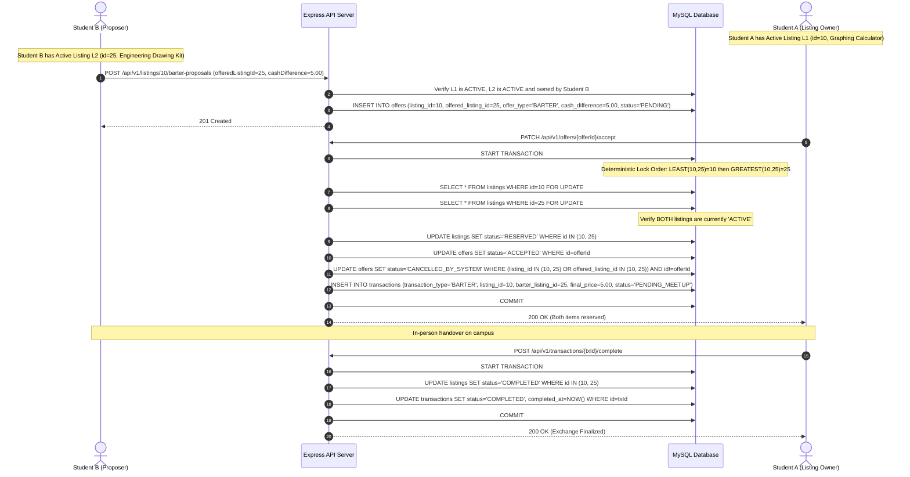
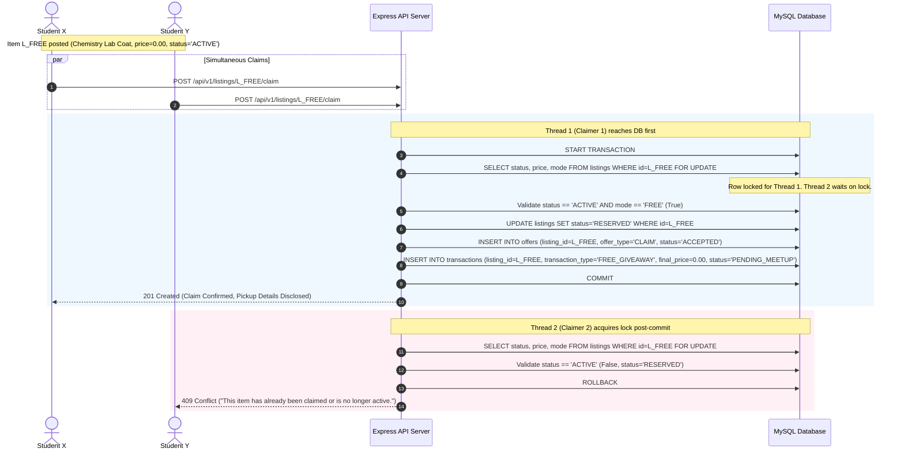

# CampusSwap — Software Requirements & Project Specification

**Document Version:** 1.0.0  
**Project Name:** CampusSwap  
**Target Environment:** Academic DBMS Mini-Project  
**Document Status:** Planned System Architecture  

---

## 1. Project Overview & Problem Statement

### 1.1 Context
College campuses host dynamic student communities where individuals regularly acquire and dispose of physical items: course textbooks, laboratory apparatus, drafting tools, graphing calculators, bicycles, dorm furniture, and consumer electronics. At the conclusion of every academic semester or graduation cycle, seniors discard or underutilize functional goods, while incoming freshmen and juniors purchase identical supplies at retail market prices.

### 1.2 Problem Statement
Existing avenues for intra-campus exchange suffer from notable structural flaws:
- **Generic Marketplace Platforms (e.g., OLX, Facebook Marketplace, Craigslist):** Lack institutional trust, expose students to anonymous external parties, demand off-campus meetups that pose physical security hazards, and offer no validation of student identity.
- **Informal Messaging Channels (e.g., WhatsApp, Telegram, Discord):** Unstructured message streams cause item listings to become buried rapidly. Search and category filtering are virtually non-existent, price negotiations create notification noise, transaction histories are unrecorded, and there is no reliable mechanism to enforce accountability or mark items as claimed.
- **Economic Inefficiency:** Students lack a dedicated avenue to donate items without friction ("Free / Giveaway") or exchange goods directly without monetary exchange ("Barter / Item Swap").

### 1.3 Solution: CampusSwap
**CampusSwap** is a dedicated, web-based, college-exclusive marketplace engineered with relational data integrity at its core. It restricts participation to verified institutional email addresses (`.edu` / `@college.edu`), supports three distinct exchange modalities (**Direct Sale**, **Item Barter**, and **Free Giveaway**), formalizes offer/counteroffer negotiations with strict database-level concurrency controls, and maintains comprehensive auditability through transactions, ratings, and moderation flags.

---

## 2. Objectives & Scope

### 2.1 Project Objectives
- **Relational Integrity Demonstration:** Model and implement a robust MySQL relational database showcasing 3NF normalization, foreign key constraints, ACID-compliant transactions, triggers, stored procedures, composite indexes, and database views.
- **Safe Campus Commerce:** Confine the user ecosystem to authenticated campus peers with verified college domain addresses and structured on-campus meetup checkpoints.
- **Multi-Modal Exchange Support:** Provide native business logic for direct cash/UPI sales, item-for-item barter (including binding user listings to barter proposals), and zero-cost free giveaways.
- **Race Condition Prevention:** Demonstrate database row-level locking (`SELECT ... FOR UPDATE`) to prevent double-claiming of free items and concurrent conflicting offer acceptances.
- **Maintainable Architecture:** Deliver a modular full-stack application separating persistent storage (MySQL 8), backend business logic (Node.js/Express REST API), and a responsive client interface (React + Vite + Bootstrap 5).

### 2.2 System Scope

#### In-Scope (Planned Core System)
- User registration, institutional email domain validation, OTP/token-based verification lifecycle, session management via JWT.
- Role-based authorization for two personas: **Student** and **Administrator**.
- Listing lifecycle management: draft/published/reserved/completed/cancelled states across categories, item conditions, and exchange types.
- Multi-mode transactions:
  - **Sell Mode (`SELL`):** Cash/negotiable listings with cash offer and counteroffer cycles.
  - **Barter Mode (`BARTER`):** Item-for-item proposals linking existing published inventory (custom descriptions deferred).
  - **Free Mode (`FREE`):** Single-click claims with first-come/first-served transactional concurrency handling.
- Audit trail and peer accountability: verified transaction logging, two-way buyer/seller reviews, and moderation report tickets.
- Relational analytics and reporting views for administrative oversight.

#### Out-of-Scope (Deferred to Future Enhancements)
- Third-party integrated payment gateway processing (e.g., Stripe, Razorpay escrow). All payments are settled peer-to-peer upon in-person handover.
- Integrated automated courier/shipping services (campus exchanges assume in-person handoffs).
- Cross-college inter-campus networking (v1 isolates exchanges to a single configured institutional domain).

---

## 3. User Roles & Permission Matrix

The system implements Role-Based Access Control (RBAC) enforced at both the API routing layer and database query constraints.

### 3.1 Roles Defined
1. **Student (Standard Verified User):** An active student possessing a verified institutional email address.
2. **Administrator (Campus Moderator / System Admin):** An elevated operational user with rights to moderate listings, triage dispute/abuse reports, manage system categories, and sanction or suspend abusive student accounts.

### 3.2 Role Permissions Matrix

| Functional Capability | Student | Administrator | Enforcement Mechanism |
| :--- | :---: | :---: | :--- |
| Register with College Email | Yes | No (Seeded/Elevated) | Regex domain check + DB Unique constraint |
| Browse & Search Active Listings | Yes | Yes | Public/Protected API query (`status = 'ACTIVE'`) |
| Manage Personal Profile & Wishlist | Yes | Personal Only | JWT user context matching `user_id` |
| Create / Edit / Delete Own Listings | Yes | All (Delete/Takedown) | Ownership verification check in backend/DB |
| Submit Offers / Propose Barters / Claim | Yes | No | Business rule: Admin accounts restricted from trading |
| Accept / Reject / Counter Incoming Offers | Yes | No | Ownership check: listing owner only |
| Mark Listing as Reserved / Completed | Yes | Yes (Override) | State machine + transactional state change |
| Submit Peer Review / Rating | Yes (Participants only)| No | Transaction participant constraint |
| Report Item / Abusive User | Yes | Dismiss / Resolve | Audit table insertion & status update |
| Manage Categories & View System Metrics | No | Yes | Admin middleware check (`role === 'ADMIN'`) |
| Suspend User / Deactivate Rogue Listing | No | Yes | Admin API updating account/listing status |

---

## 4. Core Features

Features are categorized into **Essential (MVP for Mini-Project)** and **Optional (Enhancement Scope)** to guarantee delivery within academic deadlines.

### 4.1 Feature Breakdown

```
CampusSwap Feature Matrix
├── Essential (Core Scope)
│   ├── Authentication & Domain Verification
│   ├── Item Listing Lifecycle (Sale, Barter, Free)
│   ├── Parametric Search & Filtering
│   ├── Offer, Counteroffer & Barter Negotiation Engine
│   ├── Atomic Claim System for Free Items
│   ├── Transaction Ledger & Peer Review System
│   └── Admin Moderation & Abuse Flagging
└── Optional (Academic Enhancement Scope)
    ├── Internal Asynchronous Chat / In-App Messaging
    ├── Personal Wishlist / Saved Items Notification
    ├── Advanced Aggregate Reporting Dashboard
    └── Image Upload to Cloud Object Store (vs. Local/Static URLs)
```

### 4.2 Module Specifications

#### 4.2.1 Authentication & College Email Verification
- **Registration:** Captures student full name, institutional email (e.g., `student@univ.edu`), departmental affiliation, phone number, and password (hashed with `bcrypt`).
- **Domain Verification:** System checks the email suffix against the allowed campus domains. A 6-digit cryptographic verification code with a 15-minute time-to-live (TTL) is generated and stored in a verification table.
- **Login & Sessions:** Verifies credentials; yields an HTTP-only JWT bearer token carrying `userId`, `email`, and `role`.

#### 4.2.2 Listing Creation & Inventory Management
- **Listing Modes:**
  - `SELL`: Requires a positive decimal asking price (`price > 0.00`) and specifies whether price is negotiable.
  - `BARTER`: Requires a descriptive "seeking in return" specification, optionally linked to preferred categories. Proposers offer an existing active listing owned by them, with an optional cash difference.
  - `FREE`: Price is forced to `0.00`; flags item as an immediate giveaway.
- **Item Metadata:** Title, detailed description, category ID, condition tag (`NEW`, `LIKE_NEW`, `GOOD`, `FAIR`), primary and secondary image URLs, preferred campus pickup location (e.g., "Library Foyer", "North Hall Common Room").
- **State Machine:** Listings navigate strictly through defined statuses: `ACTIVE`, `RESERVED`, `COMPLETED`, `CANCELLED`, `DELETED_BY_ADMIN`.

#### 4.2.3 Search, Discovery & Filtering
- Search across title and description using parametric filters and database indexing:
  - Text search (keyword index).
  - Categorical filtering (e.g., Textbooks, Electronics, Lab Gear, Furniture, Bicycles).
  - Listing mode filter (`SELL`, `BARTER`, `FREE`).
  - Condition filter.
  - Price range interval bounds (`min_price` to `max_price`).
  - Sorting: newest first, price ascending, price descending, highest seller rating.

#### 4.2.4 Offers, Counteroffers & Barter Proposals
- **Sale Negotiation:** A buyer proposes an offer amount (`offered_price > 0.00`). The seller may accept, reject, or submit a counteroffer amount (`counter_price > 0.00`). The buyer can subsequently accept or reject the counteroffer.
- **Barter Mechanism:** For the MVP, the system supports *Listing-to-Listing Barter* only. The prospective trader selects one of their own currently `ACTIVE` listings to bind to the proposal, with an optional cash difference (`cash_difference >= 0.00`). Freeform custom-description barter without an active listing is deferred to future enhancements. Both listings must be in `ACTIVE` status for a barter offer to be accepted.
- **Exclusivity:** Only one offer/proposal can transition a listing into the `RESERVED` state.

#### 4.2.5 Transaction Ledger & History
- Upon mutual agreement or completed claim, an immutable record is inserted into the `transactions` table.
- Captures agreed transaction type (`SALE`, `BARTER`, `FREE_GIVEAWAY`), final settlement price (cash amount for sale, or agreed cash difference for barter, or `0.00` for free giveaway), exchanged listing references (`listing_id`, `barter_listing_id`), completion timestamp, and participants (`seller_id`, `buyer_id`).

#### 4.2.6 Reviews & Peer Accountability
- Available strictly to participants of a `COMPLETED` transaction.
- Standard 1-to-5 star rating and textual feedback.
- Each user profile reflects an aggregated dynamic score calculated via database views and stored procedures.

#### 4.2.7 User Wishlist (Optional Scope)
- Students bookmark listings to a personal wishlist.
- Enables quick retrieval and price reduction tracking.

#### 4.2.8 In-App Messaging (Optional Scope)
- Structured, conversation-based message exchange linked directly to a specific `listing_id` and `offer_id`.
- Precludes sharing private phone numbers until an offer is formally accepted.

#### 4.2.9 Reporting & Administration Moderation
- Students can file moderation tickets citing reason codes (`INAPPROPRIATE_CONTENT`, `PROHIBITED_ITEM`, `SUSPECTED_SCAM`, `HARASSMENT`, `DUPLICATE_SPAM`).
- Admin console lists open reports, offers one-click listing takedown, and allows temporary or permanent suspension of offending accounts.

---

## 5. Detailed System Workflows

### 5.1 Direct Sale Workflow
```mermaid
sequenceDiagram
    autonumber
    actor Buyer as Student (Buyer)
    participant API as Express API Server
    participant DB as MySQL Database
    actor Seller as Student (Seller)

    Seller->>API: POST /api/v1/listings (Mode: SELL, Price: $50.00)
    API->>DB: INSERT INTO listings (status='ACTIVE')
    DB-->>API: Listing Created
    API-->>Seller: 201 Created

    Buyer->>API: POST /api/v1/listings/{id}/offers (Amount: $40.00)
    API->>DB: INSERT INTO offers (offer_type='PURCHASE', status='PENDING')
    DB-->>API: Offer Created
    API-->>Buyer: 201 Created

    alt Seller Accepts Direct
        Seller->>API: PATCH /api/v1/offers/{offerId}/accept
        API->>DB: START TRANSACTION; SELECT ... FOR UPDATE (Lock listing)
        API->>DB: UPDATE listings SET status='RESERVED' WHERE id=id
        API->>DB: UPDATE offers SET status='ACCEPTED' WHERE id=offerId
        API->>DB: UPDATE offers SET status='CANCELLED_BY_SYSTEM' WHERE listing_id=id AND id!=offerId
        API->>DB: INSERT INTO transactions (transaction_type='SALE', final_price=40.00, status='PENDING_MEETUP')
        API->>DB: COMMIT
        API-->>Seller: 200 OK (Item Reserved)
    else Seller Counters
        Seller->>API: POST /api/v1/offers/{offerId}/counter (Amount: $45.00)
        API->>DB: UPDATE offers SET status='COUNTERED', counter_price=45.00
        API-->>Seller: 200 OK
        Buyer->>API: PATCH /api/v1/offers/{offerId}/accept
        API->>DB: Transaction & State Reservation Execution
    end

    Note over Buyer, Seller: In-person meetup on campus; exchange item & payment
    Seller->>API: POST /api/v1/transactions/{txId}/complete
    API->>DB: START TRANSACTION
    API->>DB: UPDATE listings SET status='COMPLETED' WHERE id=id
    API->>DB: UPDATE transactions SET status='COMPLETED', completed_at=NOW() WHERE id=txId
    API->>DB: COMMIT
    API-->>Seller: 200 OK (Transaction Completed)
    
    Buyer->>API: POST /api/v1/reviews (transactionId, rating=5)
    API->>DB: INSERT INTO reviews (...)
```

### 5.2 Barter Exchange Workflow


### 5.3 Free Item Giveaway Claim Workflow (High-Concurrency)


---

## 6. Business Rules & Integrity Constraints

1. **Self-Trading Prohibition (Anti-Wash Trading):**
   - A student cannot submit an offer, propose a barter, claim, or review their own listing (`buyer_id != seller_id`). Enforced in application logic and verified via database check constraints or triggers.
2. **Deterministic Listing State Machine:**
   - Allowed status transitions:
     - `ACTIVE` $\rightarrow$ `RESERVED`, `CANCELLED`, `DELETED_BY_ADMIN`
     - `RESERVED` $\rightarrow$ `COMPLETED`, `ACTIVE` (if reservation times out or is cancelled), `CANCELLED`
     - `COMPLETED` $\rightarrow$ Terminal state (no further transitions permitted)
     - `CANCELLED` $\rightarrow$ Terminal state
   - Direct transitions from `COMPLETED` to any other state are prohibited.
3. **Offer Exclusivity & Cascade Invalidation:**
   - When an offer or barter proposal for a listing is accepted:
     - The target listing status transitions immediately to `RESERVED`.
     - In barter mode involving a linked listing, the offered listing *also* transitions to `RESERVED`.
     - All other competing pending offers or barter proposals associated with either listing are automatically updated to `CANCELLED_BY_SYSTEM`.
4. **Free Item Claim Idempotency & Concurrency:**
   - Only listings with `mode = 'FREE'` and `price = 0.00` can be processed via the claim endpoint.
   - Claims must execute inside an isolated transaction using `SELECT ... FOR UPDATE` row-level locks.
   - Once a claim is granted, no additional claims may be accepted.
5. **Review Eligibility Constraint:**
   - A review can only be submitted if an associated record exists in `transactions` with `status = 'COMPLETED'` and where `reviewer_id IN (seller_id, buyer_id)`.
   - Exactly one review per user per transaction is permitted (enforced by a composite unique key: `UNIQUE(transaction_id, reviewer_id)`).
6. **Account Standing Integrity:**
   - Suspended students (`status = 'SUSPENDED'`) are blocked by authentication middleware from creating listings, making offers, submitting claims, or posting reviews.
   - All active listings belonging to a user suspended by an admin are batch-updated to `CANCELLED`.

---

## 7. Functional & Non-Functional Requirements

### 7.1 Functional Requirements (FR)

| Req ID | Category | Description | Priority |
| :--- | :--- | :--- | :--- |
| **FR-01** | Auth | System shall validate that user emails end with the authorized college domain. | Essential |
| **FR-02** | Auth | System shall issue a 6-digit OTP code to verify new user registrations prior to activation. | Essential |
| **FR-03** | Listings | Users shall create, read, update, and soft-delete listings under SELL, BARTER, or FREE modes. | Essential |
| **FR-04** | Listings | System shall restrict image associations to validated image URLs or file payloads under 5MB. | Essential |
| **FR-05** | Search | System shall support faceted multi-parameter searching (keyword, category, condition, mode, price range). | Essential |
| **FR-06** | Offers | Buyers shall submit monetary offers on SELL items; sellers shall accept, reject, or counter. | Essential |
| **FR-07** | Barter | Users shall submit barter proposals referencing an existing active listing with optional cash difference (custom-description barter is deferred). | Essential |
| **FR-08** | Claims | Users shall claim free items with immediate atomic reservation and concurrency conflict rejection. | Essential |
| **FR-09** | Ledger | System shall record an immutable transaction record upon finalization of an exchange. | Essential |
| **FR-10** | Reviews | Participants shall rate and review counterparties post-transaction completion (1–5 scale + text). | Essential |
| **FR-11** | Admin | Administrators shall inspect flagged items, resolve moderation tickets, and ban abusive accounts. | Essential |
| **FR-12** | Wishlist | Users shall add/remove listings to a personal saved items list. | Optional |
| **FR-13** | Chat | Counterparties on an active offer shall exchange asynchronous text messages. | Optional |

### 7.2 Non-Functional Requirements (NFR)

| Req ID | Quality Attribute | Specification |
| :--- | :--- | :--- |
| **NFR-01** | **Data Consistency** | All offer acceptances, claims, and status completions must satisfy ACID properties via MySQL InnoDB transactions; zero phantom claims allowed. |
| **NFR-02** | **Performance** | API response times for indexed reads (listings browse, profile view) shall execute under 200ms under standard campus load (~50 concurrent users). |
| **NFR-03** | **Security** | Passwords salted and hashed with `bcrypt` (work factor $\ge 10$); JWT tokens signed with SHA-256 and sent via Bearer authorization headers. Client discards token upon logout. |
| **NFR-04** | **Data Integrity** | Enforce referential integrity using explicit foreign keys (`ON DELETE RESTRICT` or `ON DELETE CASCADE` where appropriate) and schema check constraints. |
| **NFR-05** | **Usability & Responsiveness** | UI constructed using Bootstrap 5 to ensure responsive rendering across mobile screens (360px+) and desktop displays (1920px). |
| **NFR-06** | **Auditability** | All soft-deletions, state changes, and transaction records must preserve timestamps (`created_at`, `updated_at`). |

---

## 8. Security & Input Validation Requirements

### 8.1 Authentication & Authorization Safeguards
- **Password Security:** Mandatory minimum of 8 characters containing at least one uppercase letter, one numeral, and one special character.
- **Role Verification:** Middleware intercepts all administrative routes (`/api/v1/admin/*`) and decrypts the JWT payload to ensure `role === 'ADMIN'`.
- **Resource Ownership Validation:** Every state-modifying request (`PUT`, `PATCH`, `DELETE`) verifies that the requesting user's `userId` matches the resource's `seller_id` or `proposer_id`.

### 8.2 Input Validation & Sanitization
- **Strict Payload Validation:** Every API route implements schema validation (e.g., using `express-validator` or `zod`):
  - `title`: String, 5–100 characters, trimmed of HTML tags.
  - `description`: String, 10–2000 characters, sanitized against XSS.
  - `price`: Decimal number with up to 2 decimal places; must be $\ge 0.00$. If `mode == 'FREE'`, enforce `price == 0.00`.
  - `category_id`: Integer, validated against active rows in `categories`.
- **SQL Injection Prevention:** 100% of database interactions execute through parameterized SQL queries via the `mysql2/promise` connection pool. String concatenation for SQL queries is strictly banned.
- **Cross-Site Scripting (XSS):** React handles automated client-side output encoding; backend sanitizes user-supplied descriptions.
- **Rate Limiting:** IP-level and account-level throttling on authentication and claim routes (e.g., max 5 claim attempts per minute) to deter bot scraping or rapid scripted claims.

---

## 9. DBMS Concepts Demonstrated (Academic Mini-Project Focus)

To meet the rigorous evaluation criteria of an academic Database Management System (DBMS) project, CampusSwap integrates core relational database principles into its core workflows:

### 9.1 Schema Normalization
- The schema is rigorously normalized up to **Third Normal Form (3NF)**:
  - **1NF:** All attributes are atomic (no comma-delimited image arrays or composite address strings; images and locations use dedicated columns or child tables).
  - **2NF:** All non-key attributes are fully functionally dependent on the primary key (no partial dependencies in junction tables like `wishlists` or `transaction_items`).
  - **3NF:** Eliminated transitive dependencies. For example, seller aggregate ratings or category names are not duplicated in the `listings` table; category data resides exclusively in `categories`, and ratings are calculated dynamically or materialized via triggers.

### 9.2 Primary & Foreign Key Constraints
- Strong relational integrity with composite foreign keys where necessary.
- Referential actions explicitly declared:
  - `categories` $\rightarrow$ `listings`: `ON DELETE RESTRICT` (prevents deleting categories containing active inventory).
  - `users` $\rightarrow$ `listings`: `ON DELETE RESTRICT` (preserves historical listings for transaction auditing; accounts use soft-deletion).
  - `listings` $\rightarrow$ `listing_images`: `ON DELETE CASCADE` (purging an uncompleted listing cleans associated image records).

### 9.3 Relational Joins
- Complex multi-table joins are utilized across core operations:
  - **Faceted Item Browse:** `INNER JOIN categories` and `INNER JOIN users` with `LEFT JOIN reviews` to retrieve listings alongside seller trust metrics.
  - **Transaction History:** `INNER JOIN listings`, `INNER JOIN users AS buyers`, and `INNER JOIN users AS sellers` with `LEFT JOIN listings AS barter_items` to render comprehensive exchange receipts.

### 9.4 Indexes & Query Optimization
- **B-Tree Indexes:**
  - `idx_listings_catalog` on `listings(status, category_id, created_at DESC)` for efficient homepage pagination.
  - `idx_listings_mode_price` on `listings(status, mode, price)` for fast faceted filtering.
  - `idx_offers_listing_status` on `offers(listing_id, status)` for rapid offer lookups.
  - Unique index `uq_users_email` on `users(email)`.
- **Full-Text Index:** `ft_listings_search` on `listings(title, description)` for natural-language search queries.

### 9.5 Database Views
1. `vw_active_listings`: Pre-filters `status = 'ACTIVE'`, joining `categories` and `users` to hide internal user credentials while exposing public seller stats.
2. `vw_user_reputation`: Computes `COUNT(reviews.id)` and `AVG(reviews.rating)` grouped by `user_id` to prevent repeated aggregation queries during browsing.
3. `vw_campus_exchange_metrics`: Administrative summary reporting total transaction volume, modal distribution (`SELL` vs `BARTER` vs `FREE`), and category turnover rates.

### 9.6 ACID Transactions & Row Locking
- High-stakes workflows run inside explicit transaction blocks:
  ```sql
  START TRANSACTION;
  -- Pessimistic row-level lock ensures no concurrent reader can claim simultaneously
  SELECT id, status, mode, price FROM listings WHERE id = ? FOR UPDATE;
  
  -- Evaluate business condition inside transaction (status == 'ACTIVE' AND mode == 'FREE')
  UPDATE listings SET status = 'RESERVED' WHERE id = ?;
  INSERT INTO offers (listing_id, buyer_id, offer_type, status) VALUES (?, ?, 'CLAIM', 'ACCEPTED');
  INSERT INTO transactions (offer_id, listing_id, seller_id, buyer_id, transaction_type, final_price, status) 
  VALUES (LAST_INSERT_ID(), ?, ?, ?, 'FREE_GIVEAWAY', 0.00, 'PENDING_MEETUP');
  COMMIT;
  ```
- Protects against dirty reads, non-repeatable reads, and lost updates during simultaneous offer acceptances and giveaways.

### 9.7 Database Triggers (Planned DBMS Deliverables)
- `trg_after_offer_accepted`: Automatically updates all other pending offers for the target (and barter) `listing_id` to `'CANCELLED_BY_SYSTEM'` when an offer status changes to `'ACCEPTED'`.
- `trg_prevent_self_offer`: Enforces anti-wash trading by signaling SQLSTATE error if `NEW.buyer_id == (SELECT seller_id FROM listings WHERE id = NEW.listing_id)`.
- `trg_update_listing_timestamp`: Automatically synchronizes `updated_at = CURRENT_TIMESTAMP` upon any modification to a listing tuple.

### 9.8 Stored Procedures (Planned DBMS Deliverables)
- `sp_finalize_sale_transaction(IN p_listing_id INT, IN p_offer_id INT)`:
  - Encapsulates parameter validation, row-locking, status updates, transaction ledger insertion, and cascade cancellation within a single compiled database routine.
- `sp_generate_monthly_campus_report(IN p_start_date DATE, IN p_end_date DATE)`:
  - Generates administrative aggregations of total items exchanged, monetary savings realized by students, and top exchange categories.

---

## 10. Project Limitations & Future Enhancements

### 10.1 Known System Limitations (Academic Scope Constraints)
- **Manual Handover Settlements:** Financial transactions are conducted in-person via cash or external UPI apps; the platform tracks agreements and completed transactions, but does not escrow funds directly.
- **Synchronous Delivery Dependency:** Exchanges require physical coordination between students on campus. The system does not support campus locker integrations or automated delivery dispatch.
- **Single Institutional Domain:** In its initial configuration, the system supports a single campus email domain (e.g., `@univ.edu`) per deployment instance.

### 10.2 Future Roadmap (Post-Mini-Project Expansion)
1. **Multi-Campus Multi-Tenancy:** Partition database schemas or apply row-level tenant filtering to allow multiple universities to operate isolated or federated exchange portals.
2. **Escrow Wallet System:** Integrate digital student ID card balances or a mock escrow wallet where funds are held by the system until both parties verify handover via a one-time delivery QR code.
3. **Automated AI Image Moderation:** Integrate vision model APIs to automatically detect and flag illicit goods, weaponry, alcohol, or prohibited coursework materials before listings go live.
4. **Push Notification Gateway:** Incorporate WebSockets or mobile push notifications (FCM) to provide real-time alerts when offers are countered or wishlist items drop in price.
5. **Physical Campus Locker Integration:** Partner with campus libraries to enable contactless drop-off and pickup using programmable, one-time locker PIN codes generated upon transaction reservation.

---

## 11. Appendix: System Architecture & Technical Specifications

### 11.1 Architectural Topology
```
[Client Tier: React + Vite + Bootstrap 5]
                     │
              HTTPS / JSON REST
                     ▼
[Application Tier: Node.js + Express.js Framework]
  ├── Security & Auth Middleware (JWT, Bcrypt)
  ├── Input Validation Layer (Express-Validator)
  ├── Route Controllers (Listings, Offers, Claims, Admin)
  └── Connection Pool Manager (mysql2/promise)
                     │
             TCP 3306 / SQL
                     ▼
[Persistence Tier: MySQL 8 Community Server (InnoDB)]
  ├── Tables & Relational Constraints (3NF)
  ├── Triggers & Stored Procedures
  ├── Analytical Views & Fulltext Indexes
  └── Transactional Row-Level Locking (SELECT ... FOR UPDATE)
```

### 11.2 Environment & Runtime Specifications
- **Node.js:** v18.x or v20.x LTS
- **Express.js:** v4.19+
- **Database Engine:** MySQL 8.0+ running the InnoDB storage engine with `utf8mb4` character set and `utf8mb4_unicode_ci` collation
- **Client Build Tool:** Vite with React 18+ and Bootstrap 5.3+
- **Version Control Strategy:** Git feature-branch workflow (`main`, `develop`, `feature/*`) hosted on GitHub
